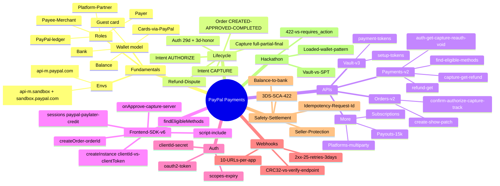
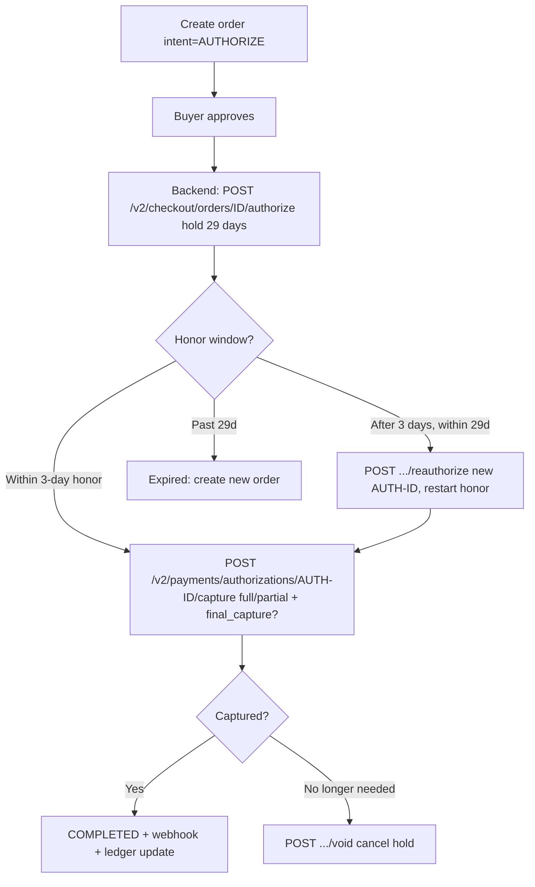
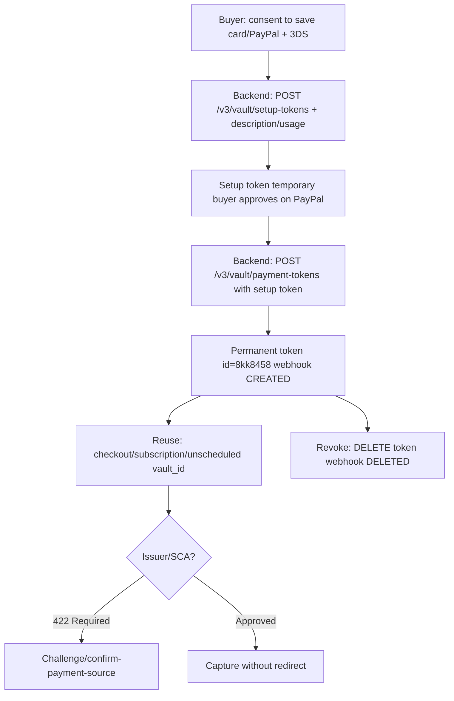
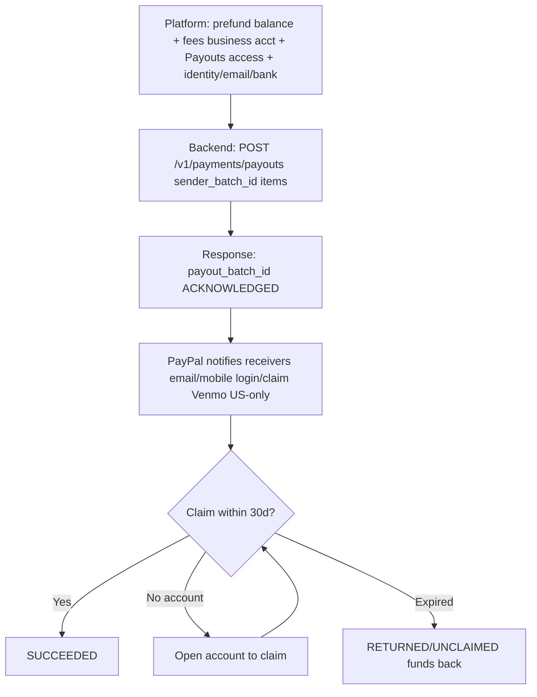
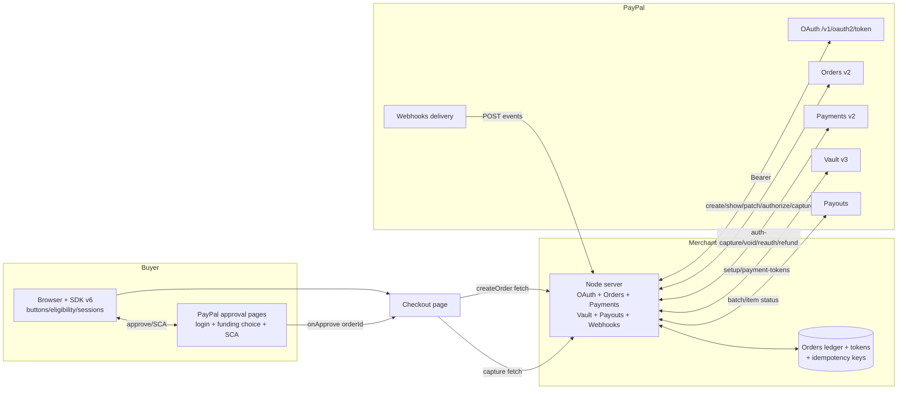
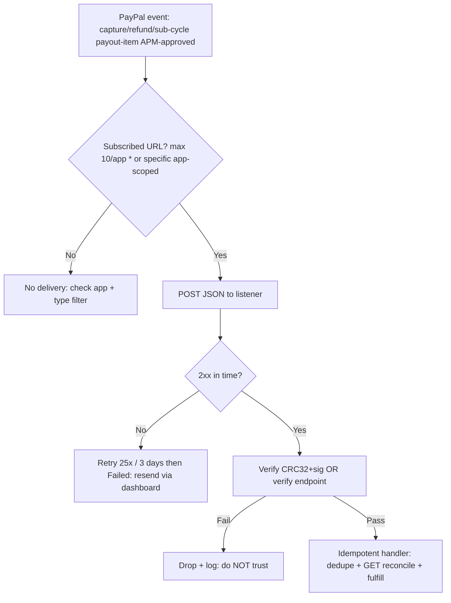

# PayPal Payments — Deep Research with Diagrams + Detailed Explanations

> Source: https://developer.paypal.com/ — verified live 2026-10-08
> Companion files: `paypal-payments-complete.md` (API details), `spt-discussion.md` (Stripe contrast)
> Generated via deep-researcher + expanded with detailed explanations

## 0. How to read this doc

- Section 1 = 30-second summary.
- Section 2 = mindmap of entire domain.
- Sections 3-8 = each area with: detailed explanation in plain words, concrete example, Mermaid diagram, key APIs, common mistakes.
- Section 9 = PayPal vs Stripe SPT mapping for hackathon (directly answers OTP / wallet / biometric questions from prior discussion).
- All diagrams render in GitHub / VS Code Mermaid preview. ASCII fallback included.

## 1. Summary

PayPal is a wallet + Orders-ledger system, not a raw card-charge system like Stripe PaymentIntents.

1. Buyer never gives card number to merchant. Buyer approves on PayPal (login + funding choice + optional SCA challenge).
2. Merchant backend creates an Order (`intent=CAPTURE` or `AUTHORIZE`), frontend JS SDK v6 gets buyer approval (`createOrder()->{orderId}` + `onApprove`), backend captures/authorizes server-side.
3. Money lands in merchant PayPal balance near-instantly (`disbursement_mode:INSTANT`), then withdraws to bank. Fees shown per capture as `seller_receivable_breakdown{gross, paypal_fee, net}`.
4. Repeat or agent-initiated charges without buyer present use Vault v3 payment tokens (`setup-token` once -> permanent `payment-token 8kk...` reusable). Mass send to many sellers uses Payouts (`POST /v1/payments/payouts`, up to 15k items, funded from balance, EMAIL/PHONE/PAYPAL_ID, Venmo US-only).
5. All REST uses OAuth2 Bearer (`CLIENT_ID:SECRET -> POST /v1/oauth2/token`, app token ~31668s, Fastlane browser token ~15 min). Async changes arrive via Webhooks (max 10 URLs/app, 2xx else 25 retries/3 days, verify via CRC32 or verify-signature endpoint).
6. There is no single-use scoped grant like Stripe `spt_xxx`. PayPal scoping must be built in app code (check seller/amount/expiry before using Vault token, `DELETE` token to revoke). Issuer/SCA step-up surfaces as `422 Payer Action Required` / `INSTRUMENT_DECLINED`, equivalent to SPT `requires_action`.

## 2. Mindmap

Detailed explanation: PayPal splits into 8 concerns. Fundamentals define who holds money. Lifecycle defines Order states. APIs define server calls. SDK defines browser calls. Auth gates everything. Webhooks notify async. Safety/Settlement moves money to bank. Hackathon maps to agent use-case.



## 3. Fundamentals explained

### 3.1 Wallet model — why merchant never sees card

In Stripe direct card flow, merchant's frontend collects PAN via Elements and backend charges it. In PayPal, PAN (if any) is entered on PayPal-hosted pages or PayPal-hosted fields. Merchant only ever handles opaque IDs: `ORDER-ID`, `AUTH-ID`, `CAPTURE-ID`, `vault-token-ID`.

Funding stack behind one PayPal approval, in priority order chosen by buyer + risk:
1. PayPal balance
2. Linked bank (ACH/SEPA)
3. Cards behind wallet (Visa/MC/Amex with network tokens)
4. Guest card (no PayPal login, Fastlane/hosted fields)
5. Pay Later / Credit (eligibility-gated loan)

Implication for hackathon: you cannot do SPT-style "clone PAN to seller". Seller gets ledger credit, not card copy. For agent-to-seller disbursement, use Payouts or multiparty Orders, not card cloning.

### 3.2 Roles with example

Example: buyer Ana buys $10 shoes from seller ShoeCo via agent ShopBot on marketplace MarketCo.

- Payer Ana (personal sandbox account, approves).
- Payee ShoeCo (business sandbox account, receives capture).
- Platform MarketCo (onboards ShoeCo via Partner Referrals, creates multiparty order with `partnerAttributionId BN_CODE` + `PayPal-Auth-Assertion`, takes fee).
- Agent ShopBot (vaults Ana's wallet once, creates order per purchase, handles SCA redirect).
- PayPal (auth, risk, ledger, FX, webhooks).

Without platform: ShopBot creates order with `purchase_units[0].payee=ShoeCo`.

### 3.3 Sandbox vs Live — detailed

| Env | API host | Web SDK | What to do |
|---|---|---|---|
| Sandbox | `https://api-m.sandbox.paypal.com` | `https://www.sandbox.paypal.com/web-sdk/v6/core` | Dashboard > Sandbox Accounts: 1 personal (buyer login in approval popup) + 1 business (see money in Recent Activity minus fees). Use card generator, `PayPal-Mock-Response` for negatives, Webhooks Simulator. |
| Live | `https://api-m.paypal.com` | `https://www.paypal.com/web-sdk/v6/core` | Live Client ID/Secret, Go-live checklist, real Payouts access approval, real bank/balance funding. |

Common mistake: using sandbox Client ID against live host or vice versa. Tokens are env-bound.

### 3.4 Payment methods explained

- PayPal wallet: login + pre-linked funding. Highest conversion, supports Vault `MERCHANT` tokens for off-session.
- Cards: hosted fields, vaultable with 3DS verification option. Good for guest.
- Venmo: US + USD only, needs US mobile + note for Payouts. Checkout via `venmo-payments` component.
- Pay Later / Credit: loan presentment, needs `productCode/countryCode` from `getDetails()`. Do not show button if `!isEligible`.
- Apple Pay / Google Pay: device-bound cryptograms, one-time, cannot be replayed (same as SPT biometric conclusion).
- Fastlane: accelerated guest, requires `clientToken` (not Client ID), iframe-based.
- SEPA / Bank: EU recurring via Vault.

Server probe `POST /v2/payments/find-eligible-methods` + client `findEligibleMethods({currencyCode})` both gate on location/currency/device/account. Always check client-side before rendering buttons; server check does not guarantee client eligibility.

## 4. Core lifecycle explained

### 4.1 Order object in words

Order = intent to pay, not money moved. Created server-side with `intent` + `purchase_units[]` (each: `amount{currency_code, value}`, `items[]`, `shipping`, `payee`, `invoice_id`, `custom_id`). Returns `id` + HATEOAS `links` (`approve`, `capture`, `authorize`, `patch`). States: `CREATED` (made, not approved) -> `APPROVED` (buyer clicked Pay) -> `COMPLETED` (captured/authorized). Valid 29 days. `PATCH` (add/remove/replace) only on `CREATED/APPROVED`. `GET` anytime for reconciliation. `track` adds carrier/tracking for seller protection.

### 4.2 CAPTURE vs AUTHORIZE — when to use which

- CAPTURE ($10 shoes in stock): charge now. One capture call completes order. Simplest, lowest failure.
- AUTHORIZE (custom shoes, ship in 5 days, final amount may vary): hold funds now, capture later. Hold valid 29 days, but capture within 3-day honor period for highest success. After honor, capture may still succeed based on risk/funds, or reauthorize for new auth ID + new honor. Sum open auths <= 115% or +$75 over order amount. Up to 10 auths/order (99 via support). Partial captures allowed; `final_capture=true` closes order.

Concrete: $10 auth, capture $9 (partial, item out of stock) + `final_capture=true` = $1 released, order closed.

### 4.3 Flowchart CAPTURE with explanation

Buyer adds to cart -> backend creates order -> SDK starts session with `{orderId}` -> buyer approves on PayPal -> `onApprove` fires with same `orderId` -> backend captures. Capture response includes `id (CAPTURE-ID)`, `status COMPLETED`, `seller_protection{ELIGIBLE, dispute_categories}`, `seller_receivable_breakdown{gross, paypal_fee, net}`.

Failure branches:
- `INSTRUMENT_DECLINED` (recoverable): call `actions.restart()` to let buyer pick another funding.
- `422 Payer Action Required` (SCA): buyer must complete challenge via `confirm-payment-source` / redirect. This is PayPal's `requires_action`.
- Other 4xx/5xx: show failure, log `debug_id`, retry with new `PayPal-Request-Id` only if safe (never auto-retry captures blindly).

```mermaid
flowchart TD
  A[Buyer: cart + click PayPal button] --> B[Backend: POST /v2/checkout/orders<br/>intent=CAPTURE + purchase_units]
  B --> C{201 Created? id + approve link}
  C -- No --> ERR[Handle 4xx/5xx + PayPal-Request-Id retry]
  C -- Yes --> D[Frontend SDK: session.start presentationMode:auto + createOrder->{orderId}]
  D --> E[Buyer approves on PayPal balance/card/bank/PayLater]
  E -- Cancel --> X[onCancel: show cart]
  E -- Error --> Y[onError: log + retry]
  E -- Approve --> F[Frontend onApprove data.orderId -> POST /capture server-side]
  F --> G[Backend: POST /v2/checkout/orders/ORDER-ID/capture]
  G --> H{Status?}
  H -- COMPLETED --> I[Confirmation + webhook PAYMENT.CAPTURE.COMPLETED + update DB]
  H -- INSTRUMENT_DECLINED --> J[actions.restart: buyer picks new funding]
  H -- 422 Payer Action Required --> K[SCA challenge: confirm-payment-source / redirect]
  H -- Other error --> L[Show failure + log debug_id]
```

### 4.4 Flowchart AUTHORIZE + CAPTURE with explanation

Create with `AUTHORIZE` -> approve -> `POST .../authorize` (hold) -> within 3 days capture via `POST /v2/payments/authorizations/{id}/capture` (optionally partial + `final_capture`). If past honor but within 29d, `POST .../reauthorize` (returns new auth ID, restart honor, capture against new ID). Day-27 reauth gives only 2 days honor left. Past 29d: order expired, create new order. `void` cancels hold if no longer needed (e.g., cancelled order).



## 5. REST APIs explained

### 5.1 Orders v2 — what each endpoint does

| Endpoint | When to call | Detailed notes |
|---|---|---|
| `POST /v2/checkout/orders` | Every checkout start | Needs `intent` + `purchase_units`. For single-step with `payment_source` (card/vault_id/billing_agreement), must send `PayPal-Request-Id` (UUID, server stores 6h, extendable to 72h via AM). Returns `id` + `approve` link. |
| `GET /v2/checkout/orders/{id}` | Poll/reconcile/webhook handler | Safe anytime. Use to confirm `status` before capture to avoid double-capture. |
| `PATCH /v2/checkout/orders/{id}` | Price/shipping/item change before completion | Only `CREATED/APPROVED`. Ops `add/remove/replace`. Example: add shipping after address callback. |
| `POST /{id}/confirm-payment-source` | Card/APM single-step | Payer confirms intent with given source. Needed for SCA flows. |
| `POST /{id}/authorize` | Hold funds | After approval, within 29d. Returns `AUTH-ID`. |
| `POST /{id}/capture` | Move money | After approval (CAPTURE intent) or after auth. Returns `CAPTURE-ID`. |
| `POST /{id}/track` + `PATCH .../trackers/{id}` | Post-ship | Adds carrier/tracking, triggers buyer notifications, supports seller protection. |

Docs: https://developer.paypal.com/docs/api/orders/v2/ (use `.md` / `schema.json` for LLM/codegen).

### 5.2 Payments v2 — what each endpoint does

- `GET /v2/payments/authorizations/{id}`: inspect hold (amount, status, expiry).
- `POST .../capture`: capture hold with `{amount, invoice_id, final_capture}`. Partial allowed.
- `POST .../reauthorize`: extend past honor (new ID). Must capture against new ID.
- `POST .../void`: cancel hold, release buyer funds.
- `GET /v2/payments/captures/{id}`: inspect capture.
- `POST /v2/payments/captures/{id}/refund`: full/partial refund with `{amount, note}`. Returns `REFUND-ID`.
- `GET /v2/payments/refunds/{id}`: inspect refund.
- `POST /v2/payments/find-eligible-methods`: server eligibility probe by input params.

Docs: https://developer.paypal.com/docs/api/payments/v2/

### 5.3 Minimal curl example explained

```bash
# 1. token: CLIENT_ID:SECRET base64 in -u, grant_type client_credentials
curl -X POST https://api-m.sandbox.paypal.com/v1/oauth2/token \
 -u "CLIENT_ID:SECRET" -d "grant_type=client_credentials"
# -> {access_token, expires_in:31668, scope, app_id}

# 2. create order CAPTURE $10
curl -X POST https://api-m.sandbox.paypal.com/v2/checkout/orders \
 -H "Authorization: Bearer ACCESS" -H "Content-Type: application/json" \
 -d '{"intent":"CAPTURE","purchase_units":[{"amount":{"currency_code":"USD","value":"10.00"}}]}'
# -> {id: ORDER-ID}

# 3. buyer approves via approve link with sandbox personal account

# 4. capture server-side (never from browser)
curl -X POST https://api-m.sandbox.paypal.com/v2/checkout/orders/ORDER-ID/capture \
 -H "Authorization: Bearer ACCESS" -H "Content-Type: application/json" -d '{}'
# -> {purchase_units[0].payments.captures[0].id, status:COMPLETED}
```

Why server-side: browser totals can be tampered. Always recompute amount from DB/cart before create/capture.

## 6. JS SDK v6 explained

### 6.1 Why v6 vs v5

v5 used `<script src=".../sdk/js?client-id=...&components=buttons">` + `paypal.Buttons({createOrder, onApprove})`. v6 uses `<script src=".../web-sdk/v6/core">` + `createInstance({clientId|clientToken})` + `findEligibleMethods` + `createPayPalOneTimePaymentSession` + `session.start({presentationMode:auto}, createOrder())`. v6 is faster, more secure, supports standalone buttons + iframe Fastlane. Both live; v6 recommended for new.

### 6.2 Step-by-step with code + explanation

Include once per page needing payments:
```html
<script src="https://www.paypal.com/web-sdk/v6/core"></script>
```

Init (Client ID for standard, clientToken only for Fastlane):
```js
const sdkInstance = await window.paypal.createInstance({
  clientId: "YOUR_CLIENT_ID",
  components: ["paypal-payments"], // + venmo-payments, googlepay-payments, applepay-payments, fastlane, paypal-messages
  pageType: "checkout",
  locale: "en-US"
});
```

Check eligibility before showing buttons (location/currency/device/account gate):
```js
const methods = await sdkInstance.findEligibleMethods({currencyCode: "USD"});
if (methods.isEligible("paypal")) configurePayPalButton(sdkInstance);
if (methods.isEligible("paylater")) {
  const {productCode, countryCode} = methods.getDetails("paylater");
  setUpPayLaterButton(sdkInstance, productCode, countryCode);
}
```

Session pattern (v6 key difference: `createOrder()` must return `{orderId}`, not raw string):
```js
const session = sdkInstance.createPayPalOneTimePaymentSession({onApprove, onCancel, onError});
paypalButton.addEventListener("click", () => session.start({presentationMode: "auto"}, createOrder()));
function createOrder() {
  return fetch("/paypal-api/checkout/orders/create", {method:"POST", body: JSON.stringify(orderPayload)})
    .then(r=>r.json()).then(data=>({orderId: data.id}));
}
async function onApprove(data) {
  await fetch("/paypal-api/checkout/orders/capture", {method:"POST", body: JSON.stringify({orderId: data.orderId})});
}
```

Best practices: obtain clientToken server-side, never expose secret, validate totals server-side, loading states, `presentationMode:auto` for popup-blocker fallback, cache tokens.

## 7. Auth explained

PayPal REST uses OAuth2 client-credentials. Client ID = username (public, safe in frontend SDK init). Secret = password (server only). Exchange via `POST /v1/oauth2/token` with `Authorization: Basic base64(CLIENT_ID:SECRET)` + `grant_type=client_credentials`. Response includes `access_token` (use as `Bearer`), `expires_in` (~31668s app token), `scope` (payments, refund, vault, payouts, subscriptions, webhooks...), `app_id`, `nonce`. Call APIs with `-H Authorization: Bearer ACCESS`. On 401/expiry, re-mint.

Fastlane browser token is different: server calls same token endpoint with `domains[] + response_type=client_token`, gets short-lived (~15 min) domain-bound token, exposes via `GET /paypal-api/auth/browser-safe-client-token`, frontend uses `createInstance({clientToken})`. Do not use Client ID for Fastlane, do not use clientToken for standard.

## 8. Vault (saved payments) explained — agent-relevant

Problem Vault solves: buyer should not re-enter card or log in for every agent purchase after first consent. Solution: 2-step tokenize then reuse.

1. `POST /v3/vault/setup-tokens` with payment source + `verification_method` (e.g., 3DS, Smart Dollar Auth) + `description` (shown on PayPal.com token page + approval) + `usagePattern` (e.g., `UNSCHEDULED_PREPAID`) + `usageType=MERCHANT` + `customer_type=CONSUMER` + `permit_multiple_payment_tokens` (true if same PayPal login maps to multiple sub-customers at merchant).
2. Buyer approves save (temporary setup token).
3. `POST /v3/vault/payment-tokens` with setup token -> permanent `id=8kk8458...` + links `self/delete`, stored in customer vault. Webhook `VAULT.PAYMENT-TOKEN.CREATED`.
4. Reuse: pass `payment_source.vault_id=8kk...` in order create for checkout/subscription/unscheduled. No redirect if issuer approves.
5. Manage: `GET .../{id}`, `GET ...` (list by customer), `DELETE .../{id}` (revoke, webhook `DELETED`).
6. If issuer/SCA step-up: `422 Payer Action Required`, buyer must challenge. Saving does not bypass OTP/SCA (same as SPT finding for ICICI).



Reference Transactions = vault + approval for flexible variable amounts (e.g., Woo subscriptions with vaulting). Needed for agent variable-amount charging.

## 9. Payouts, Subscriptions, Platforms explained

### Payouts — send to many (agent -> sellers)

Use when agent/platform must pay many recipients without each approving an order. Funded from PayPal balance (must prefund + fees). Needs business account + Payouts access approval + confirmed identity/email/bank. Supports EMAIL/PHONE/USER_HANDLE/PAYPAL_ID, wallet PAYPAL (default) / VENMO (US+USD only, needs US mobile + note). Up to 15k items/call (re-verify at build). Flow: `POST /v1/payments/payouts {sender_batch_header:{sender_batch_id (idempotency), recipient_type, email_subject/message}, items:[{receiver, amount{value,currency}, sender_item_id, note, recipient_wallet}]}` -> `{payout_batch_id, batch_status:ACKNOWLEDGED/PROCESSING}` -> PayPal notifies receivers (create account if needed, claim in 30d else RETURNED/UNCLAIMED) -> track via `GET batch?fields=batch_header`, `GET payouts-item/{id}`, webhooks `PAYOUTSBATCH.*` + `PAYOUTS-ITEM.*`. Cross-currency: separate call per currency, auto-convert + fee, response shows funding/fees.



### Subscriptions

Product (what you sell) -> Plan (how you bill: fixed/volume/tier, trial, upgrade/downgrade) -> Subscription (buyer agrees via JS button + API, cycles auto-charge with recovery). Manage via activate/suspend/cancel/revise/update/capture-outstanding + list transactions. Test via `sandbox.paypal.com/myaccount/autopay/connect` + `/billing/subscriptions`. Webhook `PAYMENT.SALE.COMPLETED` per cycle (legacy sale view) + `BILLING.SUBSCRIPTION.*`.

### Platforms / Marketplaces

Onboard sellers via Partner Referrals, create multiparty orders (platform creates order with `payee=seller` + fee), pass `partnerAttributionId BN_CODE` + `PayPal-Auth-Assertion` (iss=clientId, payer_id=seller). This is PayPal's analog to Stripe Connect `profile_xxx` network ID. SPT analogy: platform provides seller identity; here platform onboards then creates order for seller.

## 10. Architecture

Explanation: browser SDK never talks to PayPal REST directly for money movement except approval. All money calls go backend -> PayPal with Bearer. Backend keeps ledger DB (order IDs, capture IDs, vault tokens, idempotency keys). Webhooks update ledger async. This separation prevents tampering and secret leak.



## 11. Webhooks explained

Why needed: events triggered outside your system (subscription cycle, refund from dashboard, APM approved ready for capture, payout item SUCCEEDED/RETURNED). Polling is not enough.

Setup: Dashboard or API subscribe up to 10 URLs per REST app, specific types or `*`. App-scoped: payments on App A do not fire App B listeners. Legacy NVP/SOAP app separate.

Handling in code:
1. Receive fast with 2xx. Non-2xx retries 25x/3d then Failed (manual resend via Events dashboard). Must be publicly reachable (see troubleshooting delivery).
2. Verify every message: option A CRC32+signature locally, option B POST message + webhook ID + headers to verify-signature endpoint. Drop unverified.
3. Idempotent handler: use `event_id` / `resource.id` dedupe + `GET` order/capture to reconcile before updating DB/fulfilling.

Key events: `CHECKOUT.ORDER.APPROVED/COMPLETED`, `PAYMENT.AUTHORIZATION.CREATED/VOIDED`, `PAYMENT.CAPTURE.COMPLETED/DECLINED/PENDING/REFUNDED/REVERSED`, `PAYMENT.REFUND.*`, `PAYMENT.SALE.*`, `PAYMENT.PAYOUTSBATCH.*`, `PAYMENT.PAYOUTS-ITEM.* (SUCCEEDED/UNCLAIMED/RETURNED/FAILED/HELD/BLOCKED)`, `VAULT.PAYMENT-TOKEN.CREATED/DELETED`, `BILLING.SUBSCRIPTION.*`.



## 12. Security, settlement, testing explained

- Secrets: never in frontend. Only Client ID or short clientToken in browser.
- Totals: recompute server-side from cart/DB. Browser amount is untrusted.
- Idempotency: send `PayPal-Request-Id: UUID` on POSTs (single-step order with payment source, captures, payouts). Same ID returns latest status; simultaneous same-ID second may fail. Per-call-type uniqueness. Prevents double-charge on retry.
- 3DS/SCA: EU PSD2 + IN + high-risk trigger `422`. Vault setup can pre-verify with 3DS. Frontend must handle challenge/redirect, not fail silently.
- Seller Protection: capture response `ELIGIBLE` + `dispute_categories[ITEM_NOT_RECEIVED, UNAUTHORIZED_TRANSACTION]`. Preserve via confirmed address + `track` info. Inform sellers.
- Settlement: capture -> business balance near-instant (`INSTANT`). Withdraw to bank standard/instant (timing varies by country/method). `seller_receivable_breakdown` shows `gross - paypal_fee = net` per capture. For Payouts, prefund balance + fees first.
- Fees/FX: deducted from balance. Cross-currency auto-convert + fee. Payouts 96 countries/24 currencies (check exclusions), Venmo US-only. Unclaimed payout `RETURNED` in 30d.
- Testing: sandbox personal (approve at `sandbox.paypal.com` popup) + business (see money), card generator + rejection triggers, `PayPal-Mock-Response` for negatives (`MISSING_REQUIRED_PARAMETER`, `INSTRUMENT_DECLINED`), Postman public workspace, Webhooks Simulator + Events dashboard, Subscriptions autopay pages.

## 13. Hackathon mapping — PayPal vs Stripe SPT (detailed)

Context from `spt-discussion.md`: SPT moves no money; seller PaymentIntent moves money; Stripe clones `pm_xxx -> pm_yyy`; SPT `requires_action` + `handleNextAction`; ICICI OTP every charge; wallet save does not bypass; biometric replay impossible; loaded wallet decouples.

| Dimension | Stripe SPT | PayPal equivalent | What to build |
|---|---|---|---|
| Delegation primitive | `spt_xxx` single-use grant: `seller profile_xxx + usage_limits[currency/max_amount/expires_at]`, auto-`deactivated:consumed/expired/revoked` | No single-use grant. Vault reusable `8kk...` + app-enforced seller/amount/expiry + `DELETE` to revoke, webhooks `VAULT.PAYMENT-TOKEN.CREATED/DELETED` | Agent code must check `total_spent + amount <= budget && seller in allowlist && not expired` before each Vault charge. |
| PM reuse | `pm_xxx` reusable, `spt_xxx` per purchase | Setup once -> payment-token reusable for checkout/subscription/unscheduled | Same reuse shape, different scoping (reusable vs single-use). |
| OTP / step-up | `requires_action` + OTP popup every time for ICICI; saving does not bypass | `422 Payer Action Required` / `INSTRUMENT_DECLINED -> restart()`; saving Vault token does not bypass issuer/SCA | Build challenge UI (redirect/`confirm-payment-source`). Expect OTP every time for IN cards. |
| Loaded wallet (zero-touch repeat) | Pre-fund $100 once (OTP once), later spends from balance, SPT not used | Fund PayPal balance once, then capture/Payouts from balance, no per-charge card auth | Use Payouts for agent->many sellers (up to 15k/call by email/phone/ID). This is the only way to remove per-purchase bank OTP legally. |
| Biometric replay | Impossible: one-time cryptogram bound to amount/seller/time | Same: Apple/Google Pay cryptograms one-time, Vault does not cache biometrics | Do not attempt to store/replay. Will fail + violates scheme/RBI. |
| Marketplace | Connect `profile_xxx` + charge-type headers | Partner Referrals + multiparty Orders + `BN_CODE` + `PayPal-Auth-Assertion` | Platform onboards sellers, creates order with `payee=seller`, disburses via Payouts. |
| Visibility | Seller sees brand/last4/limits only, never PAN | Merchant never sees PAN, only opaque token/ledger | Same privacy posture. |

Direct answers to prior thread:
- Saving ICICI PM/Vault token does not remove OTP. Issuer checks charge, not storage.
- Wallet-at-Stripe-level does not bypass unless wallet is funded balance (different method) or network token with fresh device auth (different 2FA, not bypass).
- Only loaded wallet removes per-transaction human bank touch, but still needs human for load + instruction. Agent still needs consent per purchase.

## 14. Endpoint quick-reference + URLs

- https://developer.paypal.com/
- https://developer.paypal.com/api/rest/ (token, sandbox)
- https://developer.paypal.com/docs/api/orders/v2/
- https://developer.paypal.com/docs/api/payments/v2/
- https://developer.paypal.com/docs/api/payment-tokens/v3/
- https://developer.paypal.com/sdk/js/set-up
- https://developer.paypal.com/api/rest/webhooks/ + `/event-names/` + `/rest/` + Events dashboard + Simulator
- https://developer.paypal.com/api/rest/reference/idempotency/
- https://developer.paypal.com/docs/payouts/standard/ + `integrate-api` + `customize`
- https://developer.paypal.com/docs/subscriptions/
- https://developer.paypal.com/platforms/checkout/standard/integrate
- https://www.postman.com/paypal/paypal-public-api-workspace
- https://github.com/paypal + https://github.com/paypal-examples/v6-web-sdk-sample-integration
- https://developer.paypal.com/llms.txt + https://docs.paypal.ai/
