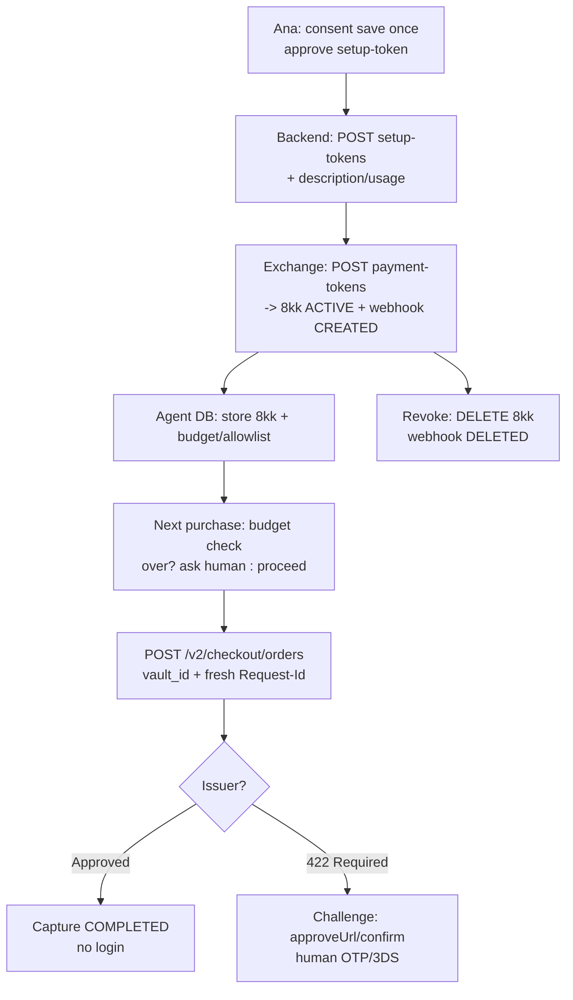

# PayPal Payments — Detailed Userflow with Examples

Date: 2026-10-09 | Dir: ~/paypalHackathon | Sources: developer.paypal.com (REST, Orders v2, Payments v2, Vault v3, Payouts, Webhooks, JS SDK v6)

## 1. Mental model

PayPal is wallet + ledger, not card-charge. Buyer approves on PayPal pages. Merchant backend creates Order, frontend SDK gets approval, backend captures. Money lands in merchant PayPal balance, then bank. Merchant never sees PAN — only opaque IDs: ORDER-ID, AUTH-ID, CAPTURE-ID, vault token 8kk....

Actors: Ana (buyer, personal sandbox), ShoeCo (seller, business sandbox), PayPal (auth/risk/ledger/settle). Platform MarketCo optional for multiparty.

Envs: sandbox `api-m.sandbox.paypal.com` + `sandbox.paypal.com/web-sdk/v6/core`; live `api-m.paypal.com` + `paypal.com/web-sdk/v6/core`. Auth: `CLIENT_ID:SECRET -> POST /v1/oauth2/token -> Bearer` (~31668s). Fastlane browser token separate (~15min).

## 2. Main userflow — $10 shoes, CAPTURE

### Step 0. Setup (once)

Merchant Dashboard > Apps & Credentials > copy Client ID + Secret. Sandbox Accounts: note personal (buyer login) + business (seller dashboard). Subscribe webhook `PAYMENT.CAPTURE.COMPLETED` to `https://shoeco.com/webhooks/paypal` (≤10 URLs/app, `*` or specific, app-scoped).

### Step 1. Ana shops

Ana browses ShoeCo, adds shoes to cart, goes to checkout, sees PayPal button. Frontend already ran:

```js
const sdk = await window.paypal.createInstance({clientId:"CLIENT_ID", components:["paypal-payments"], pageType:"checkout"});
const m = await sdk.findEligibleMethods({currencyCode:"USD"});
if (m.isEligible("paypal")) showButton();
```

This gates on location/currency/device/account. No button if ineligible.

### Step 2. Create order (backend, server-side only)

Frontend calls backend, backend computes total from DB (never trust browser):

```bash
curl -X POST https://api-m.sandbox.paypal.com/v2/checkout/orders \
 -H "Authorization: Bearer ACCESS" -H "Content-Type: application/json" \
 -d '{"intent":"CAPTURE","purchase_units":[{"reference_id":"shoes-001","description":"Running shoes","amount":{"currency_code":"USD","value":"10.00","breakdown":{"item_total":{"currency_code":"USD","value":"10.00"}}},"items":[{"name":"Running shoes","quantity":"1","unit_amount":{"currency_code":"USD","value":"10.00"}}],"shipping":{"address":{"address_line_1":"123 Main","admin_area_2":"San Jose","admin_area_1":"CA","postal_code":"95131","country_code":"US"}}}]}'
```

Response:

```json
{"id":"5O190127TN364715T","status":"CREATED","intent":"CAPTURE","purchase_units":[{...}],"links":[{"rel":"approve","href":"https://www.sandbox.paypal.com/checkoutnow?token=5O190127TN364715T"},{"rel":"self","href":"https://api-m.sandbox.paypal.com/v2/checkout/orders/5O190127TN364715T"}]}
```

Backend returns `{orderId:"5O190127TN364715T"}` to frontend `createOrder()`. Note: v6 must return `{orderId}`, not raw string.

### Step 3. Approve (Ana on PayPal)

```js
const session = sdk.createPayPalOneTimePaymentSession({onApprove, onCancel, onError});
btn.addEventListener("click", ()=> session.start({presentationMode:"auto"}, createOrder()));
async function onApprove(data){ await fetch("/api/capture",{method:"POST",body:JSON.stringify({orderId:data.orderId})}); }
```

Popup/redirect to approveUrl. Ana logs in with sandbox personal, picks funding (balance → bank → card → Pay Later), reviews $10 to ShoeCo, clicks Pay Now. Order → `APPROVED`. If issuer/SCA needs OTP/3DS (EU/IN cards), she completes challenge here via `confirm-payment-source` / redirect. Cancel → `onCancel`, error → `onError`.

### Step 4. Capture (backend)

```bash
curl -X POST https://api-m.sandbox.paypal.com/v2/checkout/orders/5O190127TN364715T/capture \
 -H "Authorization: Bearer ACCESS" -H "Content-Type: application/json" \
 -H "PayPal-Request-Id: 123e4567-e89b-12d3-a456-426655440040" -d '{}'
```

Response (trimmed):

```json
{"id":"5O190127TN364715T","status":"COMPLETED","purchase_units":[{"payments":{"captures":[{"id":"9XR60255JN8591232","status":"COMPLETED","amount":{"currency_code":"USD","value":"10.00"},"seller_protection":{"status":"ELIGIBLE","dispute_categories":["ITEM_NOT_RECEIVED","UNAUTHORIZED_TRANSACTION"]},"seller_receivable_breakdown":{"gross_amount":{"currency_code":"USD","value":"10.00"},"paypal_fee":{"currency_code":"USD","value":"0.59"},"net_amount":{"currency_code":"USD","value":"9.41"}},"disbursement_mode":"INSTANT"}]}}]}
```

$10 in ShoeCo balance instantly (minus fee). Statement shows ShoeCo, not agent. `PayPal-Request-Id` prevents double-charge on retry — reuse same UUID within window, `GET` reconcile before retry.

Failures: `INSTRUMENT_DECLINED` → `actions.restart()` let Ana pick new funding; `422 Payer Action Required` → SCA challenge; `422 intent mismatch` → wrong verb for intent; `422 breakdown` → `value != sum(breakdown)` (recompute server-side).

### Step 5. Webhook + fulfill

PayPal POSTs to listener:

```json
{"id":"WH-123","event_type":"PAYMENT.CAPTURE.COMPLETED","resource":{"id":"9XR60255JN8591232","status":"COMPLETED","amount":{"currency_code":"USD","value":"10.00"},"supplementary_data":{}}}
```

Handler: respond 2xx fast (else 25 retries/3d → Failed, manual resend), verify (CRC32+sig locally OR `POST /v1/notifications/verify-webhook-signature`), dedupe by `event_id/resource.id`, `GET /v2/payments/captures/9XR...` reconcile, then fulfill.

ShoeCo ships, adds tracking (helps Seller Protection):

```bash
curl -X POST https://api-m.sandbox.paypal.com/v2/checkout/orders/5O190127TN364715T/track \
 -H "Authorization: Bearer ACCESS" -H "Content-Type: application/json" \
 -d '{"trackers":[{"transaction_id":"9XR60255JN8591232","tracking_number":"1Z123","carrier":"UPS"}]}'
```

Ana gets confirmation. ShoeCo withdraws balance to bank (standard/instant, timing varies).

```mermaid
flowchart TD
  A[Ana: cart + PayPal click] --> B[Backend: POST /v2/checkout/orders CAPTURE]
  B --> C[Frontend: session.start + createOrder->{orderId}]
  C --> D[Ana approves on PayPal + SCA if needed]
  D --> E[onApprove orderId -> backend POST .../capture]
  E --> F[COMPLETED + balance + webhook]
  F --> G[Verify webhook + ship + track + withdraw]
```

## 3. Variation A — AUTHORIZE hold then capture (ship-later)

Same steps 1-3 but `intent:AUTHORIZE`. After approval:

```bash
curl -X POST https://api-m.sandbox.paypal.com/v2/checkout/orders/ORDER-ID/authorize -H "Authorization: Bearer ACCESS" -H "Content-Type: application/json" -d '{}'
# -> {purchase_units:[{payments:{authorizations:[{id:"AUTH-ID", status:"CREATED", expiration_time:"...29d"}]}}]}
```

Hold 29d, capture best in 3d honor. Later:

```bash
curl -X POST https://api-m.sandbox.paypal.com/v2/payments/authorizations/AUTH-ID/capture \
 -H "Authorization: Bearer ACCESS" -H "Content-Type: application/json" \
 -d '{"amount":{"currency_code":"USD","value":"9.00"},"invoice_id":"INV-1","final_capture":true}'
```

Partial $9 + `final_capture:true` releases $1, closes order. Rules: open auths ≤115%/+$75, ≤10/order (99 via support). Past honor <29d → `POST .../reauthorize` (new AUTH-ID, capture new ID; day-27 reauth = 2d left). Past 29d → new order. Cancel → `POST .../void`.

Use when: stock check, custom build, variable final amount.

## 4. Variation B — Saved/agent repeat (Vault, no re-login) — detailed

Problem: Ana does not want to log in + pick funding every time ShopBot buys for her. Solution: save once with consent, reuse via Vault token. This is PayPal analog of Stripe `pm_xxx` reuse; per-purchase Order/nonce is analog of `spt_xxx`.

### 4.1 Two tokens, two lifetimes

- `setup-token (SETUP-ID)`: temporary, single-exchange. Created from raw payment source + verification choice. Buyer approves save on PayPal token page (sees `description`). Then exchanged once for permanent token.
- `payment-token (8kk...)`: permanent reusable reference (`id:8kk8458...`, `status:ACTIVE`, links `self` + `delete`). Stored in customer vault (`customer.id: ana-123`). Used as `payment_source.{paypal|card}.vault_id` in Orders. Revoked via `DELETE`, fires `VAULT.PAYMENT-TOKEN.DELETED`.

Never store PAN. Store only `8kk...` + `customer.id`. PayPal stores actual funding.

Key fields on setup:
- `description`: shown to buyer ("Save for ShopBot — agent purchases up to $100"). Keep specific, 1-128 chars.
- `usage_pattern`: e.g. `UNSCHEDULED_PREPAID` (agent variable-amount prepaid). Tells risk/issuer expected model.
- `usage_type: MERCHANT`, `customer_type: CONSUMER`.
- `permit_multiple_payment_tokens`: true if same PayPal login maps to multiple sub-customers at merchant (distinguish Ana vs family sharing login).
- `verification_method`: e.g. `SCA_WHEN_REQUIRED`, `THREE_D_SECURE`, Smart Dollar Auth. Pre-verifies to reduce later 422.

### 4.2 First save — PayPal wallet source (Ana's main case)

Backend creates setup-token:

```bash
curl -X POST https://api-m.sandbox.paypal.com/v3/vault/setup-tokens \
 -H "Authorization: Bearer ACCESS" -H "Content-Type: application/json" \
 -d '{"payment_source":{"paypal":{"description":"Save for ShopBot agent purchases","usage_pattern":"UNSCHEDULED_PREPAID","usage_type":"MERCHANT"}},"customer":{"id":"ana-123"}}'
# -> {id:"SETUP-123", status:"CREATED", links:[{rel:"approve", href:"https://www.sandbox.paypal.com/agree/..."}]}
```

Ana opens approve link, logs in, reviews description + merchant, clicks Agree. Setup becomes `APPROVED`. Backend exchanges immediately (setup-tokens expire, do not hoard):

```bash
curl -X POST https://api-m.sandbox.paypal.com/v3/vault/payment-tokens \
 -H "Authorization: Bearer ACCESS" -H "Content-Type: application/json" \
 -d '{"payment_source":{"setup_token":"SETUP-123"}}'
# -> {id:"8kk8458...", status:"ACTIVE", links:[{rel:"self",href:".../8kk8458..."},{rel:"delete",href:"..."}]}
```

Save `{customer:"ana-123", vaultId:"8kk8458...", createdAt, scope:"agent-preapproved"}` in DB. Webhook `VAULT.PAYMENT-TOKEN.CREATED` confirms.

### 4.3 First save — card source (for card-funded agent)

Same 2-step, different source + verification:

```bash
curl -X POST https://api-m.sandbox.paypal.com/v3/vault/setup-tokens \
 -H "Authorization: Bearer ACCESS" -H "Content-Type: application/json" \
 -d '{"payment_source":{"card":{"number":"4111111111111111","expiry":"2028-12","name":"Ana","verification_method":"SCA_WHEN_REQUIRED"}},"usage_pattern":"UNSCHEDULED_PREPAID","customer":{"id":"ana-123"}}'
```

Card approve may include 3DS challenge inline. Then same `POST payment-tokens {setup_token}` exchange. Response also `8kk...` but `payment_source.card` with `brand/last4`. Reuse via `payment_source.card.vault_id` (not `paypal.vault_id` — source type must match).

### 4.4 Repeat purchase — agent uses token, no login

ShopBot wants $20 from ShopB. Agent enforces its own policy first — PayPal enforces no global budget:

```js
// Agent-side guard, mirrors SPT budget discussion
if (spentThisMonth + 20 > 100) return askHuman("Over $100 budget, approve $20 ShopB?");
if (!allowlist.has("shopb@example.com")) return askHuman("New seller, approve?");
if (Date.now() > vaultExpiry) return reSave();
```

Then single-step order with vault + fresh idempotency key:

```bash
curl -X POST https://api-m.sandbox.paypal.com/v2/checkout/orders \
 -H "Authorization: Bearer ACCESS" -H "Content-Type: application/json" \
 -H "PayPal-Request-Id: 550e8400-e29b-41d4-a716-446655440000" \
 -d '{"intent":"CAPTURE","purchase_units":[{"amount":{"currency_code":"USD","value":"20.00"},"payee":{"email_address":"shopb@example.com"},"custom_id":"ana-123|shopbot|budget-key"}],"payment_source":{"paypal":{"vault_id":"8kk8458..."}}}'
# card variant: "payment_source":{"card":{"vault_id":"8kk8458..."}}
# -> {id:"ORDER-456", status:"APPROVED"} then auto-captured, or directly COMPLETED on capture call
```

No redirect if issuer approves. Capture same as main flow (`POST .../capture` or auto-capture for single-step), money to ShopB balance, webhooks `PAYMENT.CAPTURE.COMPLETED` + `CHECKOUT.ORDER.COMPLETED`. Agent notifies Ana after: "Paid $20 ShopB, order O-456".



### 4.5 When human is still needed (no bypass)

Saving does not bypass bank/SCA — same rule as SPT + ICICI thread:

- `422 Payer Action Required` / `INSTRUMENT_DECLINED`: EU PSD2, IN cards, high amount, new seller, risk. Agent must surface `payer-action` link / `confirm-payment-source` redirect. Ana completes OTP/3DS. Order waits.
- Wallet biometric (Apple/Google via PayPal): fresh device auth per purchase, one-time cryptogram, no replay.
- Vault deleted/expired, `permit_multiple` mismatch, currency mismatch: re-save.
- Policy block: agent budget/allowlist says ask. This is app-level, not PayPal-enforced — build it or agent can charge unlimited small orders from one token.

Concrete: ICICI card saved as Vault card still OTPs every $10 ShopA + $20 ShopB. Each capture is new charge. Only pre-funded PayPal balance + Payouts avoids per-charge OTP (loaded-wallet pattern).

### 4.6 Manage: list/get/delete + webhooks

```bash
curl -X GET "https://api-m.sandbox.paypal.com/v3/vault/payment-tokens?customer_id=ana-123" -H "Authorization: Bearer ACCESS"
curl -X GET https://api-m.sandbox.paypal.com/v3/vault/payment-tokens/8kk8458... -H "Authorization: Bearer ACCESS"
curl -X DELETE https://api-m.sandbox.paypal.com/v3/vault/payment-tokens/8kk8458... -H "Authorization: Bearer ACCESS"
```

Events: `VAULT.PAYMENT-TOKEN.CREATED/DELETED/DELETION-INITIATED`. On delete, agent must drop DB row + stop charging, else `422`/404 on reuse. Ana can also revoke from PayPal.com token management — same webhook fires, agent must handle.

### 4.7 Mapping to Stripe SPT + x402 facilitator

| Stripe | PayPal Vault Variation B |
|---|---|
| `pm_xxx` reusable | `8kk...` reusable |
| `spt_xxx` per purchase scoped `profile/currency/max/expires`, auto `deactivated:consumed` | Order/nonce per purchase (`ORDER-456`), no auto single-use grant; agent enforces `amount/seller/expiry` + `DELETE` to revoke |
| `requires_action` + `handleNextAction` | `422` + `payer-action` / `confirm-payment-source` |
| `POST issued_tokens` + `PI {granted_token}` + clone `pm_xxx->pm_yyy` | `POST orders {vault_id}` + capture to balance, no clone |
| x402 MPP: `402 -> SPT -> receipt` | x402 PayPal: `verify()=GET order (amount/payee/expiry/reuse)`, `settle()=capture/sale/vault` idempotent |

In facilitator, pre-vaulted `8kk...` is what lets `settle()` run headless after one approval. Without it, every x402 retry needs interactive `approveUrl`.

### 4.8 Pitfalls for hackathon demo

- Exchange setup-token immediately; do not reuse setup-token twice.
- Fresh `PayPal-Request-Id` per new purchase; reuse only on retry of same purchase + `GET` reconcile first.
- `payment_source` type must match saved source (`paypal.vault_id` vs `card.vault_id`).
- One currency per order; cross-currency needs new order + FX fee.
- Test revoke path: delete token, show next charge fails cleanly + webhook received.
- Log `debug_id` on 422, show Ana actionable challenge link, not raw error.

## 5. Variation C — Marketplace disburse (Payouts)

MarketCo collects $10 then pays ShoeCo + others without each approving order. Prefund balance + fees, needs business + Payouts access + identity/email/bank confirmed:

```bash
curl -X POST https://api-m.sandbox.paypal.com/v1/payments/payouts -H "Authorization: Bearer ACCESS" -H "Content-Type: application/json" -H "PayPal-Request-Id: REQ" -d '{"sender_batch_header":{"sender_batch_id":"batch-001","recipient_type":"EMAIL","email_subject":"You have money!"},"items":[{"amount":{"value":"9.00","currency":"USD"},"sender_item_id":"s1","recipient_wallet":"PAYPAL","receiver":"shoeco@example.com"}]}'
# -> {batch_header:{payout_batch_id:"Y4JB...", batch_status:"PENDING"}}
```

Track `GET .../payouts/Y4JB...` + `GET .../payouts-item/ITEM-ID` (`SUCCESS/PENDING/UNCLAIMED/RETURNED/FAILED`). Venmo: `recipient_wallet:VENMO` + US mobile + note, USD only. Claim 30d else RETURNED. Up to 15k/call, separate call per currency. Webhooks `PAYMENT.PAYOUTSBATCH.*` + `PAYOUTS-ITEM.*`.

## 6. Refunds, disputes, subscriptions

Refund full/partial:

```bash
curl -X POST https://api-m.sandbox.paypal.com/v2/payments/captures/9XR60255JN8591232/refund -H "Authorization: Bearer ACCESS" -H "Content-Type: application/json" -d '{"amount":{"currency_code":"USD","value":"5.00"},"note_to_payer":"out of stock"}'
```

Disputes via Disputes API + dashboard; tracking preserves Seller Protection. Subscriptions: Product → Plan (fixed/volume/tier, trial) → Subscription via button + API, cycles fire `PAYMENT.SALE.COMPLETED`, manage activate/suspend/cancel/revise. Invoicing/Links/Buttons for no-code.

## 7. Testing checklist

- Personal approve at sandbox popup, business see money minus fee.
- Card generator + rejection triggers, `PayPal-Mock-Response` negatives (`INSTRUMENT_DECLINED`, 422).
- Postman public workspace, Webhooks Simulator + Events dashboard, Subscriptions autopay pages.
- Never trust browser totals, validate server-side; verify every webhook; idempotent handlers (`event_id`, `PayPal-Request-Id`, `sender_batch_id`).

Key URLs: /api/rest, /docs/api/orders/v2, /docs/api/payments/v2, /docs/api/payment-tokens/v3, /sdk/js/set-up, /api/rest/webhooks (+/event-names), /docs/payouts/standard, /docs/subscriptions, /platforms/checkout/standard/integrate, Postman, github paypal + v6 sample, llms.txt.
