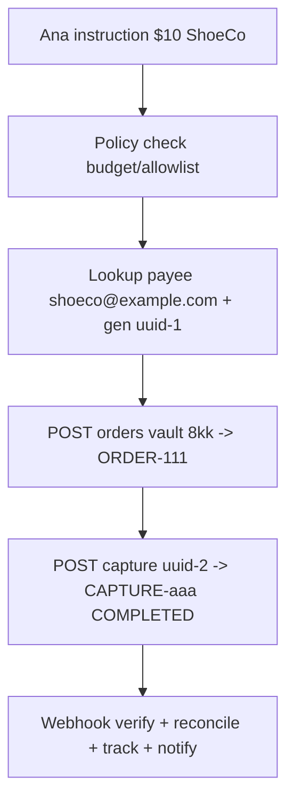

# PayPal Vault Agent Story — Detailed Doc

Date: 2026-10-09 | Dir: ~/paypalHackathon/docs | Sources: developer.paypal.com (Vault v3, Orders v2, Payments v2, Webhooks, JS SDK v6)

Story: Ana (buyer, `ana-123`) creates ShopBot (agent), saves card once, ShopBot pays $10 ShoeCo then $20 ShopB autonomously. Covers what APIs agent calls, under-hood PayPal behavior, and how agent gets values for next calls.

## Chapter 1. Ana creates ShopBot (save once)

Ana: "ShopBot, buy for me up to $100/month, only allowlisted sellers." ShopBot creates DB row `{ana:ana-123, budget:100, spent:0, allowlist:[shoeco, shopb]}`. Needs charge permission, so Vault 2-step.

1. `POST /v3/vault/setup-tokens` with raw card + `customer:{id:ana-123}` + `description:"Save for ShopBot"` + `usage_pattern:UNSCHEDULED_PREPAID` + `verification_method:SCA_WHEN_REQUIRED`.

```bash
curl -X POST https://api-m.sandbox.paypal.com/v3/vault/setup-tokens \
 -H "Authorization: Bearer ACCESS" -H "Content-Type: application/json" \
 -d '{"payment_source":{"card":{"number":"4111111111111111","expiry":"2028-12","name":"Ana","billing_address":{"address_line_1":"123 Main","admin_area_2":"San Jose","admin_area_1":"CA","postal_code":"95131","country_code":"US"},"verification_method":"SCA_WHEN_REQUIRED"}},"usage_pattern":"UNSCHEDULED_PREPAID","customer":{"id":"ana-123"}}'
# -> {id:"SETUP-123", status:"CREATED", links:[{rel:"approve", href:"https://www.sandbox.paypal.com/agree/..."}]}
```

Under hood: PayPal holds raw PAN in temporary envelope, runs risk + optional 3DS. No charge yet. Returns `SETUP-123` + approve link. ShopBot stores `SETUP-123` pending.

2. Ana approves: opens link, logs in, sees description, completes OTP. Setup -> `APPROVED`. Signal via redirect + token-page status.

3. Exchange immediately (setup single-exchange, do not hoard):

```bash
curl -X POST https://api-m.sandbox.paypal.com/v3/vault/payment-tokens \
 -H "Authorization: Bearer ACCESS" -H "Content-Type: application/json" \
 -d '{"payment_source":{"setup_token":"SETUP-123"}}'
# -> {id:"8kk8458...", status:"ACTIVE", payment_source:{card:{brand:"VISA",last4:"1111"}}, links:[{rel:"self"...},{rel:"delete"...}]}
```

Under hood: PayPal discards raw card, stores network token/FPAN internally, maps `8kk... -> ana-123 -> funding`. Fires `VAULT.PAYMENT-TOKEN.CREATED`. ShopBot persists `{vault:8kk..., brand, last4}`. Setup dead.

Fields explained: `description` shown to buyer; `usage_pattern` signals agent variable prepaid; `permit_multiple_payment_tokens:true` if shared login maps to sub-users; `customer.id` vault owner.

Card vs wallet source: card uses `payment_source.card{number,expiry,name,billing_address,verification_method}`, reuse via `payment_source.card.vault_id`. Wallet uses `payment_source.paypal{description,usage_pattern,usage_type}`, reuse via `payment_source.paypal.vault_id`. Type must match on reuse.

## Chapter 2. First agent payment — $10 shoes (full value chain)

Ana: "Buy running shoes $10 ShoeCo." ShopBot policy check: `0+10<=100` yes, `shoeco` allowlisted yes, token live yes.

### 2a. Where payee came from

ShopBot resolved "ShoeCo" -> `shoeco@example.com` (or `merchant_id`) before order:
- allowlist DB seeded at onboarding (`shoeco -> shoeco@example.com`), or
- Store Sync `search_product` -> `show_product_details` returns `payee + product_id`, or
- product page / prior order / Partner Referrals `payer_id` (preferred over email, email can change).
Demo: hardcoded. Production: catalog lookup. Unknown seller -> ask human, never guess (wrong email = wrong account).

### 2b. Where PayPal-Request-Id came from

Generated locally by ShopBot, not from PayPal. Fresh UUIDv4 per new call:

```js
const createKey = crypto.randomUUID(); // uuid-1
// DB: {attempt:uuid-1, orderId:null}
```

Purpose: idempotency. Timeout retry with same UUID returns latest status, no double order. Rules: new purchase = new UUID; retry same purchase = same UUID + `GET` reconcile first; simultaneous same-ID second may fail. Stored with order.

### 2c. Create order with vault

```bash
curl -X POST https://api-m.sandbox.paypal.com/v2/checkout/orders \
 -H "Authorization: Bearer ACCESS" -H "Content-Type: application/json" \
 -H "PayPal-Request-Id: uuid-1" \
 -d '{"intent":"CAPTURE","purchase_units":[{"amount":{"currency_code":"USD","value":"10.00"},"payee":{"email_address":"shoeco@example.com"},"custom_id":"ana-123|shopbot"}],"payment_source":{"card":{"vault_id":"8kk8458..."}}}'
# -> {id:"ORDER-111", status:"APPROVED"}
```

Under hood: resolve `8kk...` -> funding -> risk/issuer auth (off-session unscheduled, prior SCA helps) -> order APPROVED. ShopBot got `ORDER-111` from create response, updates DB `{uuid-1 -> ORDER-111}`.

### 2d. Capture

```bash
curl -X POST https://api-m.sandbox.paypal.com/v2/checkout/orders/ORDER-111/capture \
 -H "Authorization: Bearer ACCESS" -H "Content-Type: application/json" \
 -H "PayPal-Request-Id: uuid-2" -d '{}'
# -> {status:"COMPLETED", payments:{captures:[{id:"CAPTURE-aaa", seller_receivable_breakdown:{gross:"10.00",fee:"0.59",net:"9.41"}, seller_protection:{status:"ELIGIBLE"}}]}}
```

Under hood: hold -> capture -> debit Ana funding -> credit ShoeCo balance INSTANT minus fee. ShopBot got `CAPTURE-aaa` + fee/net from capture response. Updates `spent=10`, stores `ORDER-111 -> CAPTURE-aaa`.

### 2e. Webhook + fulfill

PayPal `POST {event_type:PAYMENT.CAPTURE.COMPLETED, resource:{id:CAPTURE-aaa}}` to listener. Handler: 2xx fast (else 25x/3d), verify CRC32 or `POST /v1/notifications/verify-webhook-signature`, dedupe `event_id`, `GET /v2/payments/captures/CAPTURE-aaa` reconcile, then tell ShoeCo ship + `POST .../track {tracking_number, carrier}` + tell Ana "Bought shoes O-111".



## Chapter 3. Second payment — $20 beans, no login

Ana: "Buy beans $20 ShopB." Guard `10+20<=100` yes, `shopb` allowlisted yes. Reuse same `8kk...` from DB, new UUIDs:

`POST orders {amount:20, payee:shopb, vault_id:8kk...}` -> `ORDER-222`. `POST .../ORDER-222/capture` -> `CAPTURE-bbb`. `spent=30`. Same webhooks/track.

Value chain summary: `8kk...` persisted from Ch.1 exchange; `ORDER-222` from create response; `CAPTURE-bbb` from capture response; fee/net from breakdown; next budget from `spent` accumulator. Nothing from browser except instruction. Retry rule: timeout -> `GET /v2/checkout/orders/ORDER-222` first, never blind re-POST.

## Chapter 4. When story pauses for human

- Over budget / new seller: agent policy blocks, asks "Approve $200 ShopB?" before any PayPal call.
- `422 Payer Action Required` / `INSTRUMENT_DECLINED`: issuer wants fresh OTP/3DS (EU PSD2, IN ICICI every charge, high amount, new seller). Surface `payer-action` link / `confirm-payment-source` redirect. Ana OTPs, order proceeds, IDs chain same way. Saving + prior SCA never guarantees skip.
- Deleted on PayPal.com: webhook `VAULT.PAYMENT-TOKEN.DELETED`, next use 404 -> stop + ask re-consent + new setup.
- Expired card / FPAN rotation / currency mismatch / Google vaulting terms (UCP nonce 3h, no charge+vault same nonce): re-save or new order.
- Double-charge guard: same `PayPal-Request-Id` on retry, `sender_batch_id` for Payouts, `checkout_session_id/orderId` dedupe for ACP, `GET` before fulfill.

Loaded-wallet note: only pre-funded PayPal balance + Payouts avoids per-charge card OTP. Vault alone does not. Biometric cryptograms one-time, no replay.

## Pitfalls checklist

- Exchange setup immediately, never reuse setup-token.
- Fresh Request-Id per purchase; reuse only on retry + reconcile.
- Source type match (`card.vault_id` vs `paypal.vault_id`).
- One currency per order; server computes totals (`value == sum(breakdown)` or 422).
- Reference Transactions approval for variable unscheduled live amounts.
- Log `debug_id` on 422, show challenge link.
